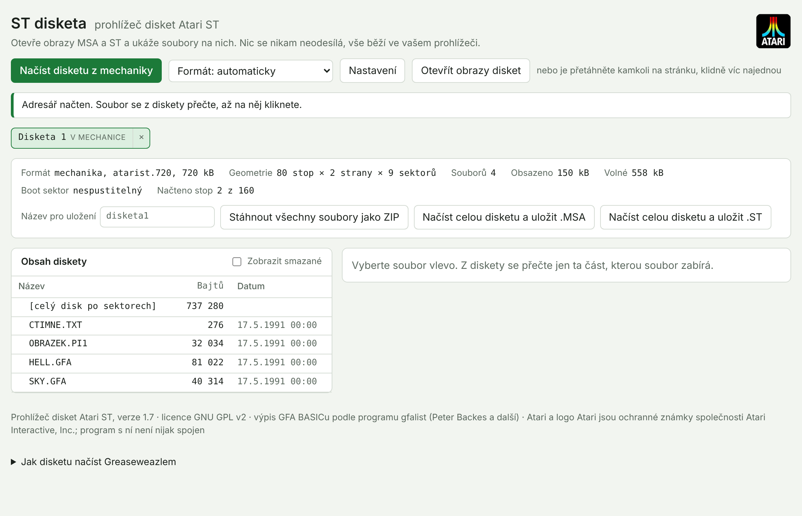
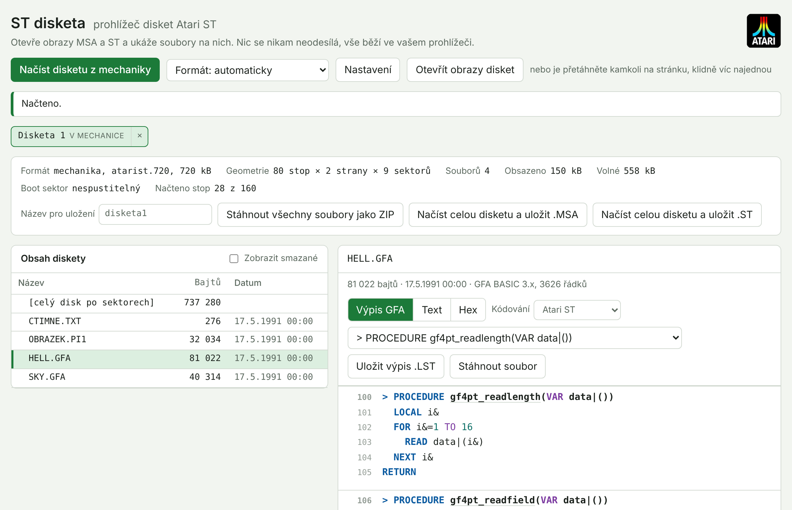

# ST disketa – Atari ST floppy browser for Greaseweazle

🇨🇿 [Česky](README.md) · 🇬🇧 **English**

Put an Atari ST floppy into a drive connected to a **Greaseweazle**, click "Načíst disketu" (Read disk) and
a few seconds later you see its directory. A file is read from the disk only when you click it. A full disk
image (MSA or ST) is made only when you actually want one.



*Author: Zdeněk Kotrba · © 2026 · version 1.7 · [changelog](CHANGELOG.en.md)*

> The page itself is in Czech. The English manual translates every label you need.

---

## Why

Imaging a whole floppy takes time, and you rarely want everything on it. The directory, however, sits entirely
on the first track. So the program reads only what is needed at the moment:

| What you want | What is read from the disk |
|---|---|
| see what is on the disk | track 0 and the tracks holding subdirectories |
| view or download one file | only the tracks that file occupies |
| a full image (MSA, ST) or all files | the rest of the disk; tracks already read are not read again |

## Features

- **Reads straight from the drive** through Greaseweazle and detects the format itself (9, 10 or 11 sectors, one or two sides).
- **Views files without an emulator**: text (Atari ST, Kamenický, Windows-1250, ISO 8859-2, UTF-8 encodings),
  hex dump, Degas (PI1–PI3, PC1–PC3), NEOchrome and Doodle pictures, raw 640×400 screens (e.g. `.PIC`).
- **Lists GFA BASIC 3.x programs** (`.GFA`) with syntax colouring, line numbers and a jump list of procedures; saves them as `.LST`.
- **Saves** a single file, all files as a ZIP, a `.MSA` or `.ST` disk image, a picture as PNG.
- **Existing images** (`.MSA`, `.ST`) can be dropped onto the page, several at once.
- **Disks without a directory** (games with custom formats) can be browsed sector by sector.
- Deleted files, volume label, free space, boot sector state.
- Path to `gw`, serial port and drive are set on the page.



## Requirements

- a **Greaseweazle** with a floppy drive, and [Greaseweazle Tools](https://github.com/keirf/greaseweazle) installed (`gw.exe` or `gw`)
- **Python 3.8 or newer** – nothing else to install, only the standard library is used
- a web browser (Chrome, Edge, Firefox)

Tried on Windows with a real Greaseweazle. The same file runs on Linux; it has not been tried there with a real
drive yet, and the user needs access to the serial port (usually the `dialout` group).

## Quick start

1. Download [`st_disketa.py`](st_disketa.py).
2. Run it:
   ```
   python st_disketa.py
   ```
   (or `py st_disketa.py` on Windows). The page `http://127.0.0.1:8737/` opens in your browser.
3. If `gw` is not found, **Nastavení** (Settings) opens. Enter the path to `gw.exe`, optionally the port
   (e.g. `COM5`) and the drive, save, and click **Otestovat spojení** (Test connection).
4. Insert a floppy and click **Načíst disketu z mechaniky** (Read disk from drive).

Full illustrated manual: **[docs/ST_disketa_manual_v1.7_EN.pdf](docs/ST_disketa_manual_v1.7_EN.pdf)**

Command-line options (optional, they override saved settings):

```
python st_disketa.py --gw "C:\Greaseweazle\gw.exe" --device COM5 --drive A --port 8737 --no-browser
```

## Viewing images only, without Python

[`st_prohlizec.html`](st_prohlizec.html) is the same page without drive access. Open it in a browser and drop
`.MSA` or `.ST` images onto it.

## Limitations

- At most 80 tracks per side are read; disks formatted to 81–82 tracks are not read completely.
- Copy-protected disks and custom formats have no directory and can only be browsed by sector.
  To archive those, use `gw read` directly with SCP or HFE output.
- The GFA BASIC lister handles GFA BASIC 3.x files (3.0 as well as 3.5 and later). Files from GFA BASIC 1.x and 2.x are shown as hex.
- Programs saved with protection (PSAVE) contain no variable names; placeholder names are shown.
- The page is in Czech.

## Repository layout

| Path | Contents |
|---|---|
| `st_disketa.py` | the finished single-file program (local server + page) |
| `st_prohlizec.html` | stand-alone page for viewing `.MSA` and `.ST` images only |
| `src/page.html` | page source (HTML, CSS, JavaScript) |
| `src/gfa.js`, `src/gfa_tables.js` | GFA BASIC lister (JavaScript port of gfalist) |
| `src/server_template.py` | source of the local server that calls `gw` |
| `build.py` | builds `st_disketa.py` and `st_prohlizec.html` from `src/` |
| `tools/gen_gfa_tables.py` | converts the token tables from gfalist |
| `tools/build_manual.py` | builds the PDF manuals from `docs/src/` |
| `docs/` | manual in Czech and English (PDF), pictures |
| `CHANGELOG.en.md` | what changed in each version |

After editing the sources run `python build.py`. The version number lives in one place, `src/server_template.py`.

## How it works

`st_disketa.py` starts a small web server that listens on `127.0.0.1` only. The page tells it which tracks it
needs, the server runs `gw read --format=atarist.… --tracks=…` and returns their contents. Parsing of the FAT12
file system, the MSA container, pictures and GFA BASIC is done by the page itself in the browser. Nothing leaves
your computer.

## Licence and credits

The program is licensed under the **GNU GPL version 2** (see [LICENSE](LICENSE)) and comes with no warranty.

- The GFA BASIC lister is a port of **gfalist / SKY**, © 1992–2001 Peter Backes, with later fixes by
  Markus Hoffmann and others ([mmuman/gfalist](https://github.com/mmuman/gfalist), GPL v2). That is why this whole project is GPL v2 as well.
- Disks are read by Keir Fraser's **Greaseweazle** ([keirf/greaseweazle](https://github.com/keirf/greaseweazle)).

Atari and the Atari logo (`src/logo.png`) are trademarks of Atari Interactive, Inc. The logo is used here only to
show what the program is for; it is not covered by the GPL and the project is not affiliated with Atari.
