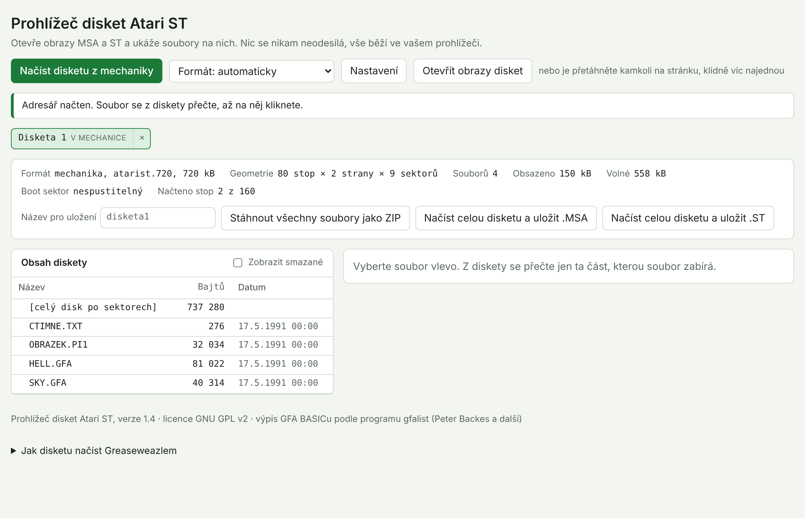
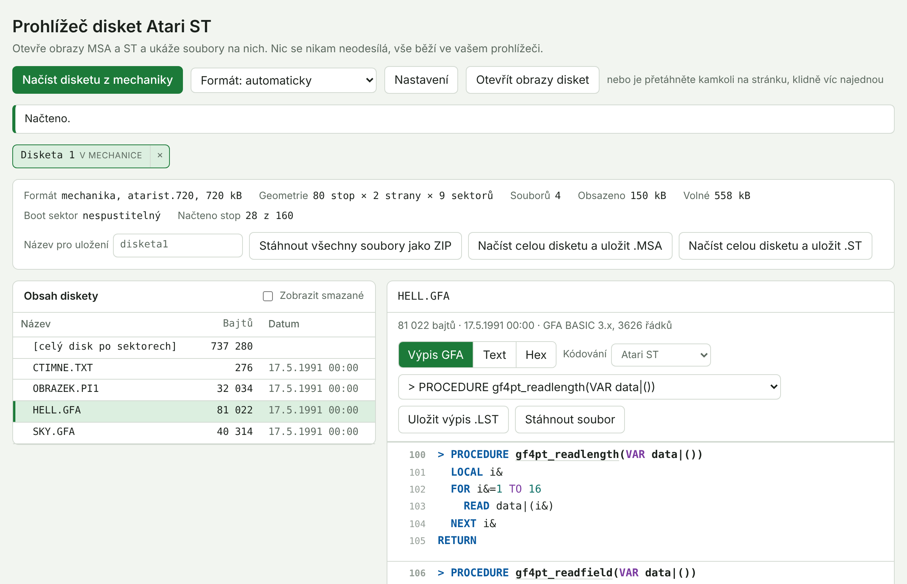

# ST disketa – prohlížeč disket Atari ST přes Greaseweazle

🇨🇿 **Česky** · 🇬🇧 [English](README.en.md)

Vložíte disketu z Atari ST do mechaniky připojené ke **Greaseweazle**, kliknete na „Načíst disketu“ a za pár
sekund vidíte její adresář. Soubor se z diskety přečte, až když na něj kliknete. Celý obraz (MSA nebo ST) se
vytvoří teprve tehdy, když ho opravdu chcete.



*Autor: Zdeněk Kotrba · © 2026 · verze 1.4 · [seznam změn](CHANGELOG.md)*

---

## Proč

Vytvoření obrazu celé diskety trvá a ne všechno z disket člověk chce. Adresář diskety přitom leží celý na
první stopě. Program proto čte jen to, co je právě potřeba:

| Co chcete | Co se z diskety čte |
|---|---|
| vidět obsah diskety | stopa 0 a stopy s podadresáři |
| prohlédnout nebo stáhnout jeden soubor | jen stopy, na kterých soubor leží |
| obraz celé diskety (MSA, ST) nebo všechny soubory | zbytek diskety, už načtené stopy se nečtou znovu |

## Co umí

- **Čtení přímo z mechaniky** přes Greaseweazle, formát diskety pozná sám (9, 10 nebo 11 sektorů, jedna nebo dvě strany).
- **Prohlížení souborů bez emulátoru**: text (kódování Atari ST, Kamenických, Windows-1250, ISO 8859-2, UTF-8),
  hex výpis, obrázky Degas (PI1–PI3, PC1–PC3), NEOchrome a Doodle.
- **Výpis programů GFA BASIC 3.x** (`.GFA`) s barevným zvýrazněním, čísly řádků a skokem na procedury; uložení jako `.LST`.
- **Ukládání**: jeden soubor, všechny soubory jako ZIP, obraz diskety `.MSA` nebo `.ST`, obrázek jako PNG.
- **Hotové obrazy** `.MSA` a `.ST` stačí přetáhnout na stránku, klidně víc najednou.
- **Diskety bez adresáře** (hry s vlastním formátem) jdou projít po sektorech.
- Smazané soubory, jmenovka diskety, volné místo, stav boot sektoru.
- Nastavení cesty ke `gw`, portu a mechaniky přímo na stránce.



## Co je potřeba

- **Greaseweazle** s disketovou mechanikou a nainstalované [Greaseweazle Tools](https://github.com/keirf/greaseweazle) (`gw.exe` nebo `gw`)
- **Python 3.8 nebo novější** – nic dalšího se neinstaluje, program používá jen standardní knihovnu
- prohlížeč (Chrome, Edge, Firefox)

Vyzkoušeno na Windows se skutečným Greaseweazlem. Na Linuxu běží stejný soubor; se skutečnou mechanikou tam zatím
vyzkoušen nebyl a uživatel musí mít přístup k sériovému portu (obvykle skupina `dialout`).

## Rychlý start

1. Stáhněte soubor [`st_disketa.py`](st_disketa.py).
2. Spusťte ho:
   ```
   python st_disketa.py
   ```
   (na Windows případně `py st_disketa.py`). V prohlížeči se otevře stránka `http://127.0.0.1:8737/`.
3. Když program nenajde `gw`, otevře se **Nastavení**. Zadejte cestu ke `gw.exe`, případně port (např. `COM5`)
   a mechaniku, uložte a klikněte na **Otestovat spojení**.
4. Vložte disketu a klikněte na **Načíst disketu z mechaniky**.

Podrobný návod s obrázky: **[docs/ST_disketa_navod_v1.4.pdf](docs/ST_disketa_navod_v1.4.pdf)**

Volby na příkazové řádce (nepovinné, mají přednost před uloženým nastavením):

```
python st_disketa.py --gw "C:\Greaseweazle\gw.exe" --device COM5 --drive A --port 8737 --no-browser
```

## Jen prohlížení obrazů, bez Pythonu

Soubor [`st_prohlizec.html`](st_prohlizec.html) je tatáž stránka bez čtení z mechaniky. Stačí ho otevřít
v prohlížeči a přetáhnout na něj obrazy `.MSA` nebo `.ST`.

## Omezení

- Čte se nejvýš 80 stop na stranu; diskety formátované na 81–82 stop se nenačtou celé.
- Diskety s ochranou proti kopírování nebo vlastním formátem nemají adresář a jdou projít jen po sektorech.
  Na jejich archivaci použijte přímo `gw read` do formátu SCP nebo HFE.
- Výpis GFA BASICu umí jen formát verze 3.5 a novější. Starší soubory (GFA 2.x, 3.0) se zobrazí jako hex.
- Programy uložené s ochranou (PSAVE) nemají v souboru jména proměnných, vypíší se s náhradními jmény.
- Stránka je česky.

## Struktura repozitáře

| Cesta | Obsah |
|---|---|
| `st_disketa.py` | hotový program v jednom souboru (místní server + stránka) |
| `st_prohlizec.html` | samostatná stránka jen pro prohlížení obrazů `.MSA` a `.ST` |
| `src/page.html` | zdroj stránky (HTML, CSS, JavaScript) |
| `src/gfa.js`, `src/gfa_tables.js` | výpis GFA BASICu (převod programu gfalist do JavaScriptu) |
| `src/server_template.py` | zdroj místního serveru, který volá `gw` |
| `build.py` | sestaví `st_disketa.py` a `st_prohlizec.html` ze složky `src/` |
| `tools/gen_gfa_tables.py` | převod tabulek tokenů z gfalist |
| `tools/build_manual.py` | sestaví PDF návody z `docs/src/` |
| `docs/` | návod česky a anglicky (PDF), obrázky |
| `CHANGELOG.md` | co se změnilo v jednotlivých verzích |

Po úpravě zdrojů stačí spustit `python build.py`. Číslo verze je na jediném místě, v `src/server_template.py`.

## Jak to funguje

`st_disketa.py` spustí malý webový server, který poslouchá jen na adrese `127.0.0.1`. Stránka mu říká, které
stopy potřebuje, server zavolá `gw read --format=atarist.… --tracks=…` a vrátí jejich obsah. Rozbor souborového
systému FAT12, kontejneru MSA, obrázků i výpis GFA BASICu dělá stránka sama v prohlížeči. Nic se neodesílá
mimo váš počítač.

## Licence a poděkování

Program je pod licencí **GNU GPL verze 2** (viz [LICENSE](LICENSE)), bez jakékoli záruky.

- Výpis GFA BASICu je převod programu **gfalist / SKY**, © 1992–2001 Peter Backes, s pozdějšími opravami
  Markuse Hoffmanna a dalších ([mmuman/gfalist](https://github.com/mmuman/gfalist), GPL v2). Proto je pod GPL v2 i celý tento projekt.
- Čtení disket dělá **Greaseweazle** Keira Frasera ([keirf/greaseweazle](https://github.com/keirf/greaseweazle)).
